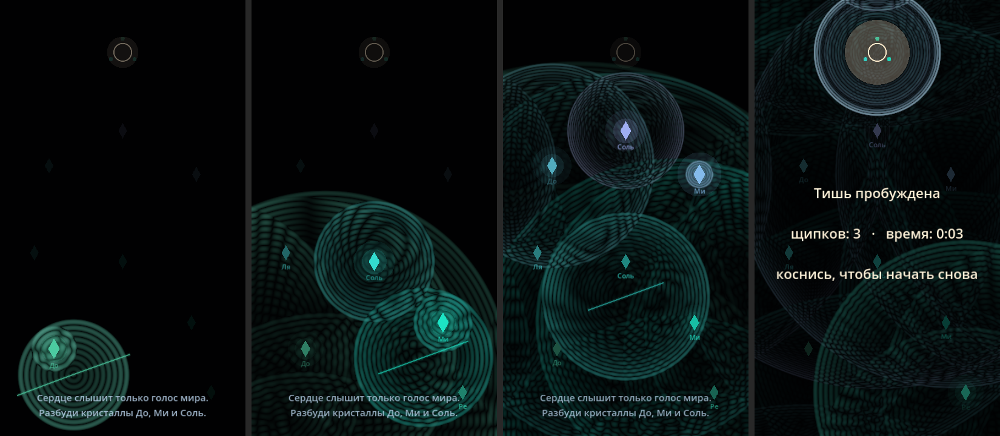

# RESONA: Последний Настройщик

> *Мир замолчал. Каждая вещь помнит свою ноту.*

Android-игра, где звук — это свет. Натягиваешь пальцем струну, отпускаешь её,
и по тёмному миру расходится физически честная волна. Если нота совпадает с
нотой кристалла, тот откликается и будит соседей: так возникает цепная реакция.

**Статус:** прототип 0.1 «Одна струна» (Godot 4.3, GL Compatibility).



## Как играть в прототип

| Жест | Что происходит |
|---|---|
| Коснуться и тянуть | Натягивается струна. **Длиннее — ниже нота.** Каждый полутон отдаётся щелчком вибрации |
| Отпустить | Щипок: волна света и звука. Чем дольше держал, тем сильнее волна |
| Короткий тап | «Эхолокация»: тихий импульс подсвечивает спрятанные кристаллы |

**Цель:** Сердце (круг наверху) слышит только голоса кристаллов. Разбудите
кристаллы **До, Ми и Соль** так, чтобы их волны дошли до Сердца одновременно
(в пределах 3.5 с). Звучит только унисон и октава (сильно), квинта и кварта
(слабо). Цепная реакция затухает сама, потому что каждое поколение тише предыдущего.

## Как получить APK на телефон

После каждого push GitHub Actions собирает APK:
- **Actions → последняя сборка → Artifacts → `resona-apk`** (zip с APK внутри);
- с ветки `main` дополнительно: **Releases → «Последняя сборка RESONA»**, прямая ссылка на APK.

На телефоне разрешите установку из неизвестных источников.

## Разработка

```bash
# запустить на ПК (мышь эмулирует касания)
godot --path .
# автотест: автоигрок проходит уровень; код выхода 0 = Сердце пробудилось
godot --headless --path . -- --autoplay
```

## Структура

```
scenes/main.tscn          корневая сцена
scripts/main.gd           механика: струна, волны, резонанс, Сердце, отрисовка
scripts/synth.gd          процедурный звук: Karplus-Strong, колокол, фон
scripts/haptics.gd        тактильная отдача
shaders/waves.gdshader    волны + интерференция + отражения (GPU)
tools/autoplay.gd         автоигрок для CI
docs/GDD.md               дизайн-документ
TASKS.md                  дорожная карта и задачи
CLAUDE.md / GEMINI.md     правила для ИИ-разработчиков
```

## Команда

- **Claude (Claude Code)** — основной разработчик: архитектура, код, коммиты.
- **Gemini (Code Assist)** — ревьюер pull request'ов, анализ скриншотов и видео.
- **Человек** — режиссёр: играет, чувствует, решает.
